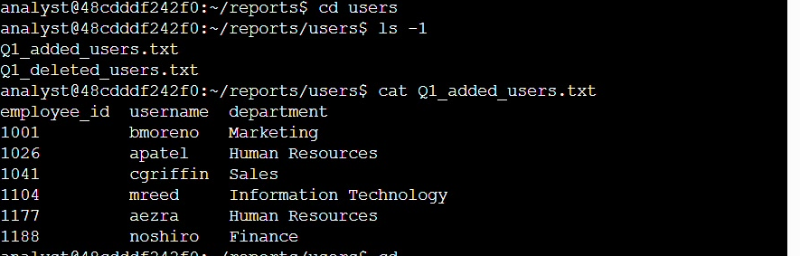
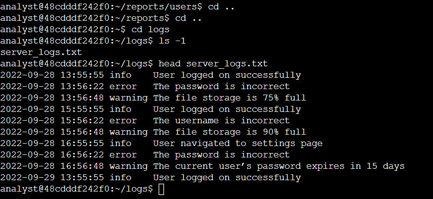

# Linux Lab: Finding and Reading Files

  

Hands-on Linux lab from the Google Cybersecurity Professional Certificate. I used the command line to navigate a file system, read a user report, and review a server log.

**Commands:** `pwd` `ls -l` `cd` `cat` `head`

## What I Did

1. **Located myself:** `pwd` and `ls -l` showed `/home/analyst` with four directories: `logs`, `projects`, `reports`, `temp`.
2. **Moved and listed:** `cd reports` then `ls -l` showed one subdirectory, `users`.
3. **Read a user report:** `cd users`, `ls -l`, then `cat Q1_added_users.txt` showed six new employees with their IDs, usernames and departments.
4. **Reviewed a server log:** `cd ..` twice, `cd logs`, then `head server_logs.txt` showed the first 10 entries.

## Log Findings

| Severity | Count | Examples |
|---|---|---|
| info | 4 | Successful logins, settings page visit |
| warning | 3 | Storage at 75% then 90%, password expiring in 15 days |
| error | 3 | Two incorrect passwords, one incorrect username |

- Three failed logins in about three hours are most likely typos, but repeated failures are what analysts watch for credential guessing.
- Storage rose from 75% to 90% in two hours and is worth monitoring.
- Ten lines are too few to judge intent. A real review would read the whole file.

## What I Learned

- Navigating Linux from the command line with `pwd`, `ls` and `cd`
- Reading user records with `cat` for access and account review
- Previewing large logs with `head` before digging in
- Triaging log entries by severity (info, warning, error)
- Spotting patterns worth investigating, like repeated failed logins

**Next:** `find`, `grep`, filtering larger logs, and file permissions.

**Author:** Sali Mohatli ([GitHub](https://github.com/SaliMohatli))
